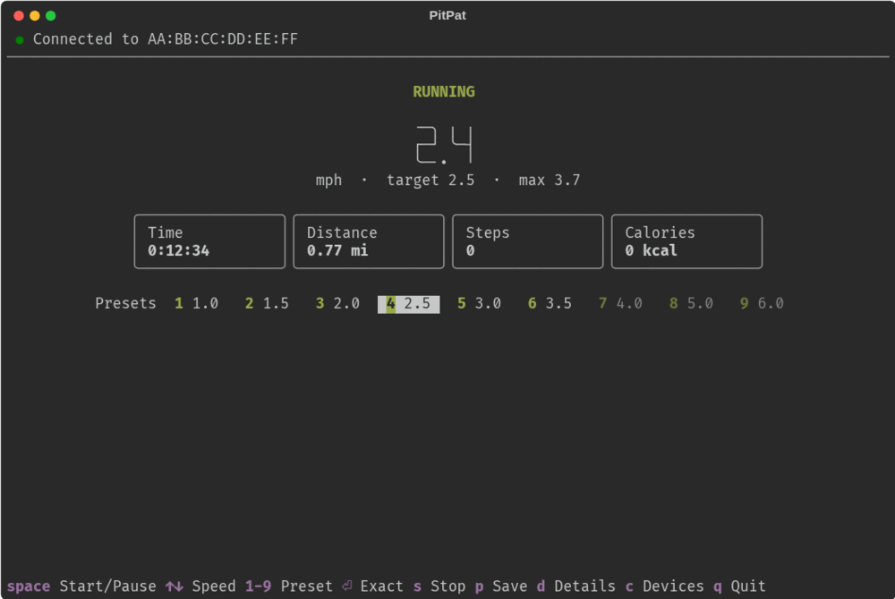

# PitPat Treadmill Control



An unofficial terminal app to control and monitor a PitPat treadmill over Bluetooth.
It remembers your treadmill, so getting walking is one command:

```bash
pitpat 2.5      # connect to the last treadmill and start the belt at 2.5
```

---

## Install

Needs **Python 3.10+** and a Bluetooth adapter. Works on Linux and Windows.

The easiest way is [uv](https://docs.astral.sh/uv/), which installs `pitpat` into its
own environment and puts the command on your PATH:

```bash
uv tool install git+https://github.com/azmke/pitpat-treadmill-control.git
```

Get uv with `pacman -S uv`, `brew install uv`, `winget install astral-sh.uv`, or
[the installer](https://docs.astral.sh/uv/getting-started/installation/).
`pipx install git+https://…` works the same way.

From a clone, `uv tool install -e .` runs the checkout directly, so your edits
take effect without reinstalling. To update, run `uv tool upgrade pitpat`; to
remove, `uv tool uninstall pitpat`.

Then run `pitpat` (or `python -m pitpat`).

## Usage

```
pitpat [SPEED] [--scan] [--address ADDR] [--variant {fba0,ba04}] [--verbose]
```

- **First run:** it scans for treadmills. If it finds exactly one, it connects
  straight away. Otherwise you pick one from the list or type its address.
- **After that:** it reconnects to the same treadmill right away, without scanning.
  Use `--scan` or press `c` to choose a different one.
- **`SPEED`:** starts the belt at that speed as soon as it's connected.
- **Dropped connection:** it keeps retrying until the treadmill is back.

### Keys

| Key | Action |
| --- | --- |
| `Space` | Start / pause (resumes at the last speed) |
| `↑` `↓` (or `+` `-`) | Speed ±0.1 |
| `1`–`9` | Go to a preset speed, starting the belt if it's stopped |
| `Enter` | Type an exact speed |
| `s` | Stop (pauses first if the belt is running) |
| `p` then `1`–`9` | Save the current speed as that preset |
| `d` | Show or hide details (incline, firmware, serial, …) |
| `c` | Choose a different treadmill |
| `q` / `Ctrl+C` | Quit (pauses the belt first if it's running) |

Speeds use whatever unit the treadmill's own display uses (km/h or mph), and are
capped at its maximum. Presets above the maximum are dimmed.

### Settings and logs

The last treadmill and your presets are kept in `config.json`, and logs in
`pitpat.log`, both in:

- Linux: `~/.config/pitpat/`
- Windows: `%APPDATA%\pitpat\`

You can edit `presets` in the config by hand. It holds up to nine speeds.

---

## Compatible devices

- PitPat T01 (BA04)
- PitPat T01, firmware 37 (`fba0` variant). See [docs/FIRMWARE-VARIANT.md](docs/FIRMWARE-VARIANT.md)

The variant is detected automatically when connecting. To report another
working model, open an [issue](https://github.com/azmke/pitpat-treadmill-control/issues)
or pull request.

## Troubleshooting

- **Treadmill not found:** don't connect it from your desktop's Bluetooth panel or
  the PitPat phone app. A BLE device stops advertising while something else holds
  it. On Linux, pitpat drops a stale BlueZ link on its own before connecting.
  Pairing isn't needed.
- **Windows:** run it natively, not in WSL2, which has no Bluetooth stack. Clearing a
  stale link is Linux-only, so if the scan comes up empty, close other apps using
  the treadmill or turn it off and on again.
- Run with `--verbose` to log every status frame to `pitpat.log`.

## Development

```bash
uv run --extra test pytest
```

| File | What it does |
| --- | --- |
| `pitpat/protocol.py` | Command packets and status-frame decoding |
| `pitpat/ble.py` | Scanning and the Bluetooth connection |
| `pitpat/app.py` | The terminal UI (built with [Textual](https://textual.textualize.io)) |
| `pitpat/config.py` | Saved settings |

---

## License

[MIT](LICENSE)

## Disclaimer

This project is an independent, unofficial tool and is **not affiliated with, endorsed by, or associated with PitPat or JOYFIT INC**. It was developed from scratch for non-commercial, personal experimentation and educational purposes, based solely on publicly observable interactions with PitPat treadmills to enable interoperability. No proprietary code, assets, or intellectual property from PitPat or JOYFIT INC have been used or incorporated. This tool is not intended to bypass security measures or violate any terms of service. This software is provided 'as-is', without any warranties, express or implied, and the author assumes no responsibility for any damage, malfunction, or warranty issues resulting from its use. Use at your own risk and ensure compliance with applicable laws and terms of service.
